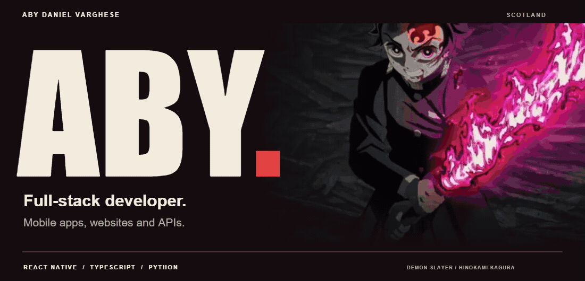
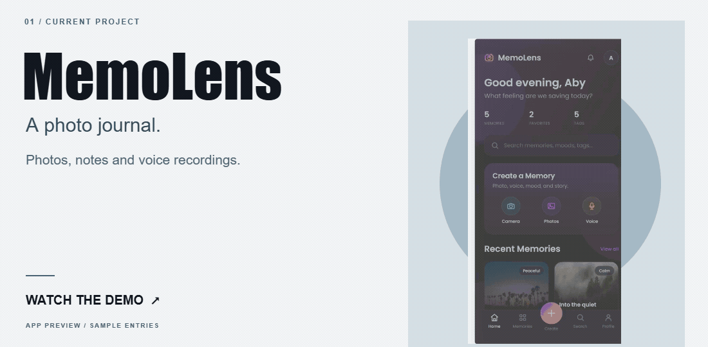
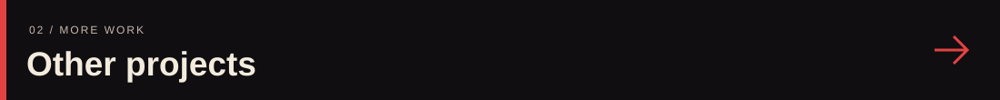
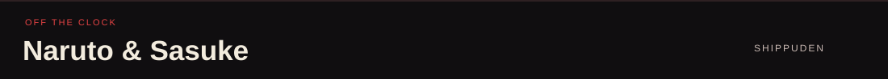

<a href="https://aby-portfolio-gules.vercel.app">
  <picture>
    <source media="(prefers-reduced-motion: reduce) and (max-width: 640px)" srcset="./assets/cinema/hero-mobile-still.png" />
    <source media="(prefers-reduced-motion: reduce)" srcset="./assets/cinema/hero-still.png" />
    <source media="(max-width: 640px)" srcset="./assets/cinema/hero-mobile.gif" />
    
  </picture>
</a>

  <a href="https://aby-portfolio-gules.vercel.app"><strong>PORTFOLIO ↗</strong></a> &nbsp; / &nbsp;
  <a href="https://www.linkedin.com/in/aby639"><strong>LINKEDIN ↗</strong></a> &nbsp; / &nbsp;
  <a href="https://aby-portfolio-gules.vercel.app/cv/Aby-Daniel-Varghese-CV.pdf"><strong>CV ↓</strong></a> &nbsp; / &nbsp;
  <a href="mailto:sunnyvarghese25007@gmail.com"><strong>EMAIL ↗</strong></a>

I'm **Aby Daniel Varghese**. I build mobile apps, websites and APIs. I'm based in Scotland and studying for an MSc in Information Technology with Web Development at **UWS**.

Right now, I'm working on **MemoLens**. I'm also an anime fan.

 

<a href="https://www.youtube.com/watch?v=bV9s-qFNM9c">
  <picture>
    <source media="(prefers-reduced-motion: reduce) and (max-width: 640px)" srcset="./assets/cinema/memolens-mobile.png" />
    <source media="(prefers-reduced-motion: reduce)" srcset="./assets/cinema/memolens.png" />
    <source media="(max-width: 640px)" srcset="./assets/cinema/memolens-mobile.gif" />
    
  </picture>
</a>

Save photos with captions, moods, tags and optional voice notes. Entries stay on your device, with favourites and search.

**React Native · Expo · TypeScript · AsyncStorage**

[Watch the demo](https://www.youtube.com/watch?v=bV9s-qFNM9c) &nbsp; / &nbsp; [Code](https://github.com/aby639/my-gallery) &nbsp; / &nbsp; [Project details](https://aby-portfolio-gules.vercel.app/work/memolens)

Personal project in testing. Voice recording runs on Android and iOS; the demo uses the web version with sample entries.

  

<picture>
  <source media="(max-width: 640px)" srcset="./assets/cinema/projects-mobile.svg" />
  
</picture>

### [RAG News Chatbot ↗](https://github.com/aby639/RAG-Powered-Chatbot-for-News-Websites)
Questions about news articles, answered with source links and session history. 
React · Express · Qdrant · Gemini · Redis

### [Product Data Explorer ↗](https://github.com/aby639/product-explorer)
Browse books from World of Books and refresh their saved details. 
Next.js · NestJS · TypeScript · PostgreSQL

### [ScentMatch AI ↗](https://github.com/aby639/ScentMatch-AI-)
A fragrance assistant that matches requests against a perfume catalogue. 
Python · Google ADK · Gemini · Streamlit

 

<strong>Website projects ↗</strong>

 

Four website concepts for fictional businesses.

**[ClydeCraft](https://aby-portfolio-gules.vercel.app/work/clydecraft)** — a trades website concept with a material selector and sample quote form.

**[Cairn House](https://aby-portfolio-gules.vercel.app/work/cairn-house)** — a website concept for a Highland retreat.

**[Alderwick House](https://aby-portfolio-gules.vercel.app/work/alderwick-house)** — a care-home website concept with visiting information.

**[Morrow Studio](https://aby-portfolio-gules.vercel.app/work/morrow-studio)** — a salon website concept with a style selector and sample booking flow.

 

**Tools I use** 
React · React Native · Next.js · TypeScript · Python · Django · FastAPI · NestJS · PostgreSQL · Redis 
Git · Docker · Postman · Motion · GSAP · Playwright · Jest · Vitest

  

<picture>
  <source media="(max-width: 640px)" srcset="./assets/cinema/naruto-title-mobile.svg" />
  
</picture>
<picture>
  <source media="(prefers-reduced-motion: reduce)" srcset="./assets/after-hours/naruto-sasuke-supplied-static.png" />
  
</picture>

Naruto here. Demon Slayer up top.

Clip credits

The Demon Slayer opening uses [this clip shared on Tenor](https://tenor.com/view/demon-slayer-kimetsu-no-yaiba-kimetsu-demon-slayer-gif-802320408899345404). Naruto and Demon Slayer footage belongs to its respective creators and rights holders.

 

### My contribution snake

<picture>
  <source media="(prefers-reduced-motion: reduce)" srcset="./assets/after-hours/contributions-still.png" />
  <source media="(prefers-color-scheme: dark)" srcset="https://raw.githubusercontent.com/aby639/aby639/output/github-contribution-grid-snake-dark.svg" />
  
</picture>

  

<a href="mailto:sunnyvarghese25007@gmail.com">
  <picture>
    <source media="(max-width: 640px)" srcset="./assets/cinema/contact-mobile.svg" />
    
  </picture>
</a>

[Email](mailto:sunnyvarghese25007@gmail.com) &nbsp; / &nbsp; [LinkedIn](https://www.linkedin.com/in/aby639) &nbsp; / &nbsp; [Portfolio](https://aby-portfolio-gules.vercel.app)
