<a href="https://aby-portfolio-gules.vercel.app">
  <picture>
    <source media="(prefers-reduced-motion: reduce) and (max-width: 640px)" srcset="./assets/after-hours/welcome-mobile-still.png" />
    <source media="(prefers-reduced-motion: reduce)" srcset="./assets/after-hours/welcome-still.png" />
    <source media="(max-width: 640px)" srcset="./assets/after-hours/welcome-mobile.gif" />
    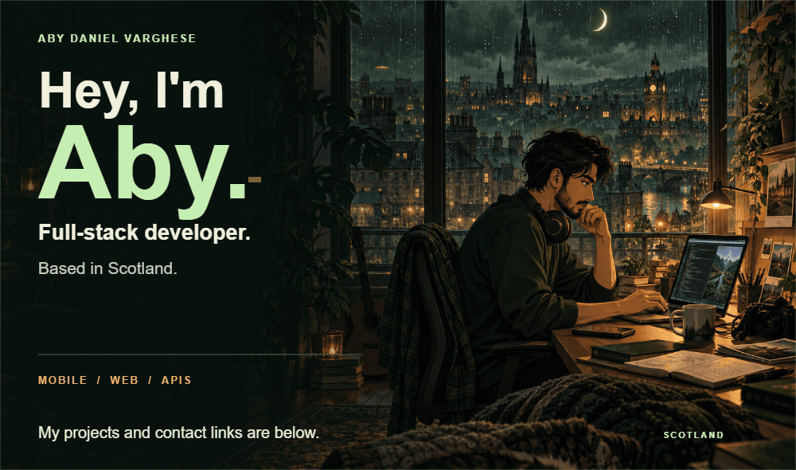
  </picture>
</a>

  <a href="https://aby-portfolio-gules.vercel.app"><strong>PORTFOLIO ↗</strong></a>
  &nbsp; · &nbsp;
  <a href="https://www.linkedin.com/in/aby639"><strong>LINKEDIN ↗</strong></a>
  &nbsp; · &nbsp;
  <a href="https://aby-portfolio-gules.vercel.app/cv/Aby-Daniel-Varghese-CV.pdf"><strong>CV ↓</strong></a>
  &nbsp; · &nbsp;
  <a href="mailto:sunnyvarghese25007@gmail.com"><strong>EMAIL ↗</strong></a>

### Hi, I'm Aby.

I'm **Aby Daniel Varghese**, a full-stack developer based in Scotland. I'm studying for an MSc in Information Technology with Web Development at **UWS**. I build mobile apps, websites and APIs.

I'm currently working on **MemoLens**, a photo journal built with React Native and Expo. You'll find it below, along with some of my other projects.

 

<a href="https://aby-portfolio-gules.vercel.app/work/memolens">
  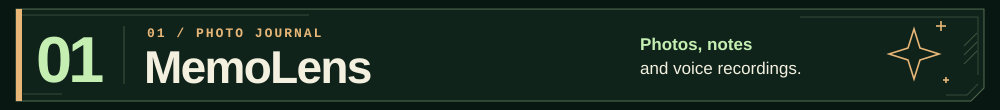
</a>

### MemoLens

**MemoLens** lets you save photos with captions, moods, tags and optional voice notes. It stores entries on your device, with favourites and search by caption, mood or tag.

<a href="https://www.youtube.com/watch?v=bV9s-qFNM9c">
  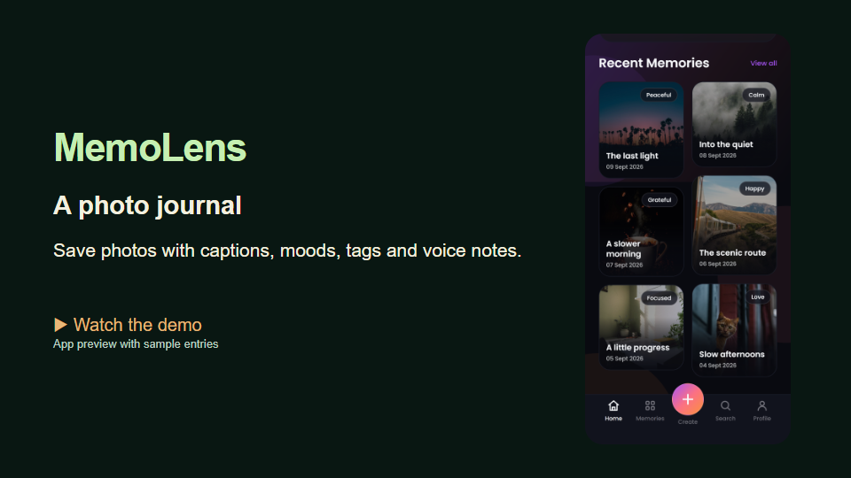
</a>

**[▶ Watch the demo](https://www.youtube.com/watch?v=bV9s-qFNM9c)** &nbsp; · &nbsp; [Source code](https://github.com/aby639/my-gallery) &nbsp; · &nbsp; [Project details](https://aby-portfolio-gules.vercel.app/work/memolens)

**React Native · Expo · TypeScript · AsyncStorage** 
This is a personal project in testing. Voice recording runs on Android and iOS; the demo shows the web version with sample entries.

 

## Other projects

<a href="https://github.com/aby639/RAG-Powered-Chatbot-for-News-Websites">
  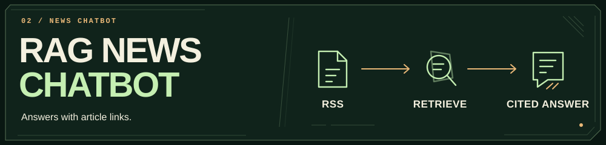
</a>

**[RAG News Chatbot ↗](https://github.com/aby639/RAG-Powered-Chatbot-for-News-Websites)** 
A chatbot that answers questions about news articles, cites its sources and keeps session history. 
React · Express · Qdrant · Gemini · Redis

<a href="https://github.com/aby639/product-explorer">
  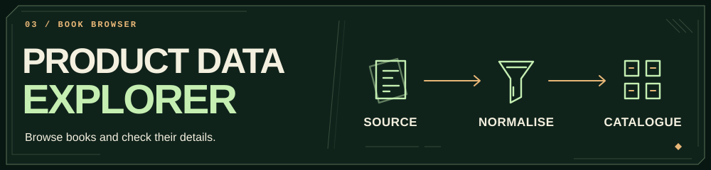
</a>

**[Product Data Explorer ↗](https://github.com/aby639/product-explorer)** 
A book browser using data from World of Books, with saved details and a refresh button. 
Next.js · NestJS · TypeScript · PostgreSQL

**[ScentMatch AI ↗](https://github.com/aby639/ScentMatch-AI-)** 
A fragrance assistant that matches requests against a perfume catalogue. 
Python · Google ADK · Gemini · Streamlit

<strong>Website projects ↗</strong>

 

Four website concepts for fictional businesses.

<a href="https://aby-portfolio-gules.vercel.app/work/clydecraft">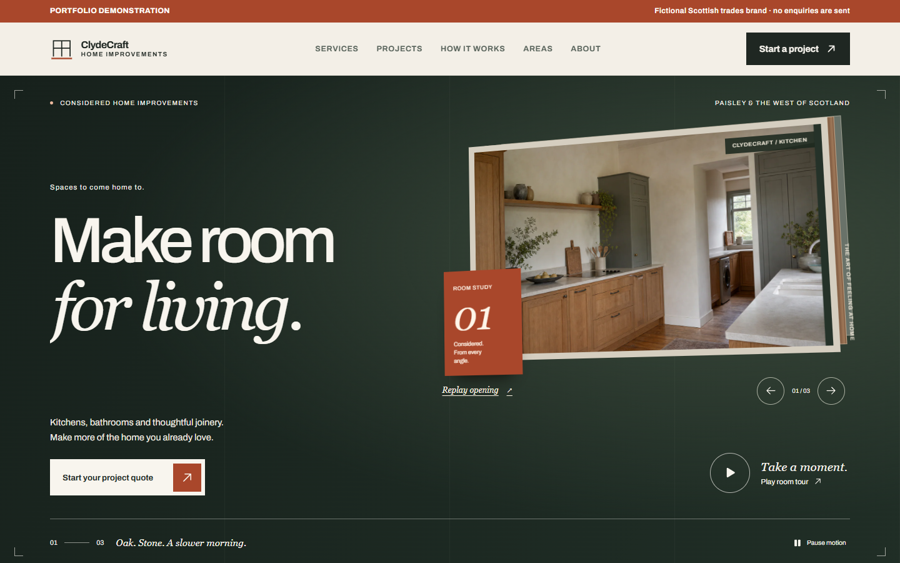</a>

**[ClydeCraft](https://aby-portfolio-gules.vercel.app/work/clydecraft)** — a trades website concept with a material selector and sample quote form.

<a href="https://aby-portfolio-gules.vercel.app/work/cairn-house">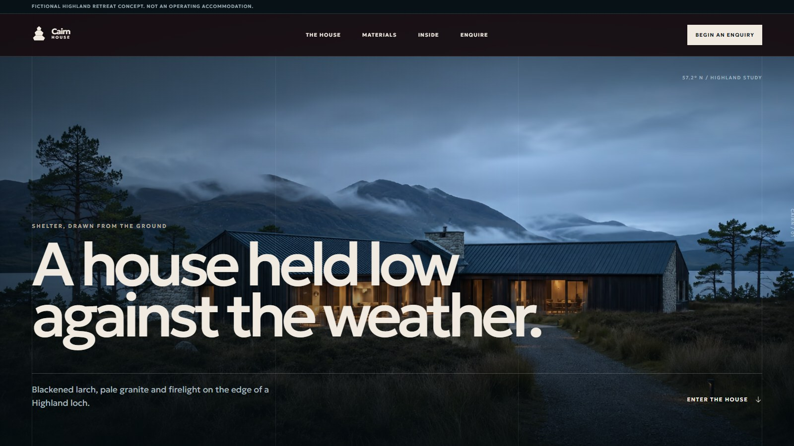</a>

**[Cairn House](https://aby-portfolio-gules.vercel.app/work/cairn-house)** — a website concept for a Highland retreat.

<a href="https://aby-portfolio-gules.vercel.app/work/alderwick-house">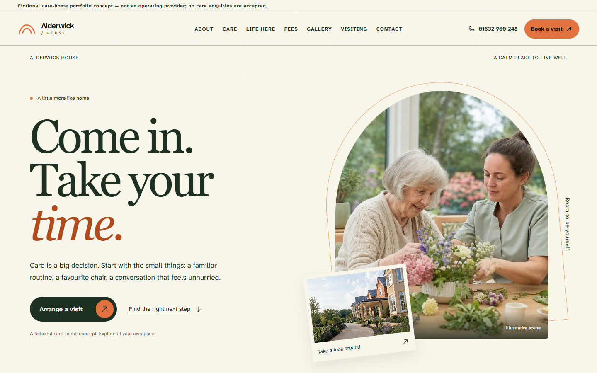</a>

**[Alderwick House](https://aby-portfolio-gules.vercel.app/work/alderwick-house)** — a care-home website concept with visiting information.

<a href="https://aby-portfolio-gules.vercel.app/work/morrow-studio">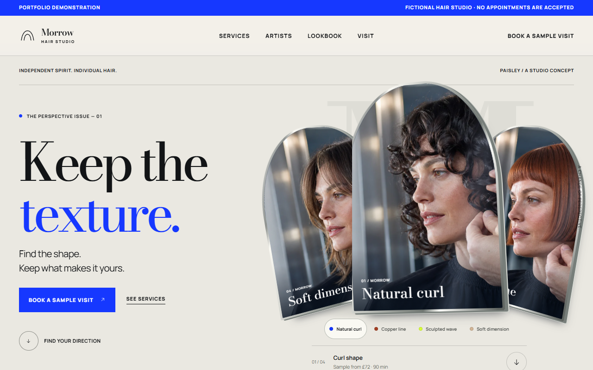</a>

**[Morrow Studio](https://aby-portfolio-gules.vercel.app/work/morrow-studio)** — a salon website concept with a style selector and sample booking flow.

 

## Tools I use

**Interfaces** &nbsp; React · React Native · Next.js · TypeScript 
**Services & data** &nbsp; Python · Django · FastAPI · NestJS · PostgreSQL · Redis 
**Motion & testing** &nbsp; Motion · GSAP · Playwright · Jest · Vitest 
**Day to day** &nbsp; Git · Docker · Postman

 

## Anime

I'm also an anime fan.

<strong>▶ Naruto & Sasuke</strong>

 

<picture>
  <source media="(prefers-reduced-motion: reduce)" srcset="./assets/after-hours/naruto-sasuke-supplied-static.png" />
  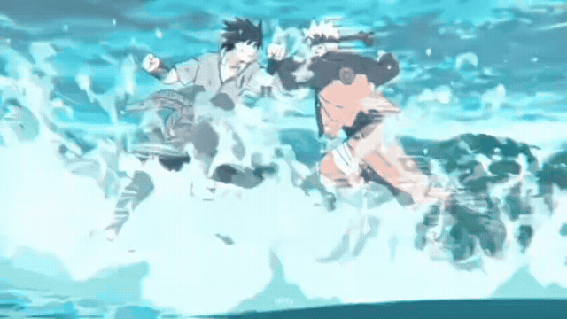
</picture>

Naruto footage belongs to its respective creators and rights holders.

<strong>↳ Watch my contribution snake</strong>

 

<picture>
  <source media="(prefers-reduced-motion: reduce)" srcset="./assets/after-hours/contributions-still.png" />
  <source media="(prefers-color-scheme: dark)" srcset="https://raw.githubusercontent.com/aby639/aby639/output/github-contribution-grid-snake-dark.svg" />
  
</picture>

 

<a href="mailto:sunnyvarghese25007@gmail.com">
  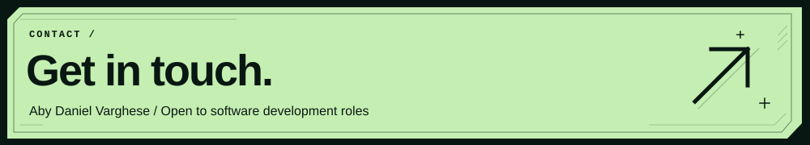
</a>

I'm looking for **software development roles**. You can reach me by email or LinkedIn.

[Email](mailto:sunnyvarghese25007@gmail.com) &nbsp; · &nbsp; [LinkedIn](https://www.linkedin.com/in/aby639) &nbsp; · &nbsp; [Portfolio](https://aby-portfolio-gules.vercel.app) &nbsp; · &nbsp; [CV](https://aby-portfolio-gules.vercel.app/cv/Aby-Daniel-Varghese-CV.pdf)
